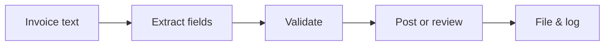

# Invoice Processing Automation

> Turn invoice text from email, WhatsApp photos or folder drops into checked, ready-to-post accounting entries.

     

**Sector:** Finance & Accounting  ·  **Project 1 of 50** in my [AI Automation Projects series](https://github.com/Princewill106/Princewill106)

## The problem

Growing businesses end up paying someone to retype invoices into accounting software. It is slow, and the errors that slip through (a misread total, the same invoice paid twice) cost real money. Extraction alone is not enough: an extraction model will confidently misread 8,500 as 850 or miss a line, so without checks you have automated your errors rather than your typing.

## How it works



1. **Ingest** — Invoice text arrives (OCR output from an email attachment, WhatsApp photo or folder drop). The demo reads `sample_invoices.json`.
2. **Extract** — Supplier, invoice number, dates, line items, subtotal, VAT and total are pulled out with patterns, or with an LLM when a key is configured.
3. **Validate** — Line items must add up to the subtotal, subtotal + VAT must equal the total, the supplier must be known and the invoice number must not have been seen before.
4. **Route** — Clean invoices are marked ready to post. Anything that fails a check goes to a review queue with the exact reason attached.
5. **Log** — Results are written to `output/` as JSON and CSV so they can be imported into accounting software.

## Features

- Field extraction for supplier, number, dates, line items, VAT and total
- Arithmetic checks on line items, subtotal, VAT and total
- Duplicate invoice detection across the batch
- Unknown-supplier flagging against a supplier master list
- Review queue with human-readable reasons
- CSV export ready for import into accounting tools

## Quick start

```bash
git clone https://github.com/Princewill106/invoice-processing-automation.git
cd invoice-processing-automation
python main.py --demo
```

No installs needed: it uses only the Python standard library. The demo runs fully offline using the sample data in this repo.

**Optional: plug in an LLM.** Copy `.env.example` to `.env` and add an Anthropic or OpenAI key. The project will then use the model for the language-heavy steps and fall back to its rule-based logic if a call fails.

Run the tests:

```bash
python -m unittest -v
```

## Sample output

```text
Mode: offline rules
Processed 6 invoices: 3 ready to post, 3 need review

  POST    INV-1042   Lagos Office Supplies Ltd  NGN   130,075.00
  POST    EPS-221    Eko Power Solutions        NGN   247,250.00
  POST    IPH-077    Ikeja Print House          NGN   155,875.00
  REVIEW  INV-1042   Lagos Office Supplies Ltd 
          - duplicate of invoice INV-1042
  REVIEW  QF-9       QuickFix Generators       
          - unknown supplier 'QuickFix Generators'
  REVIEW  APL-556    Apapa Logistics Co        
          - subtotal + VAT = 1,096,500.00 but total says 1,069,500.00

Saved output/posted.csv and output/review_queue.json
```

## Use it in n8n (no code needed)

[`n8n-workflow.json`](n8n-workflow.json) is a ready-to-import n8n version of this project, built for n8n 1.x.

1. In n8n, open **Workflows → Import from File** and choose `n8n-workflow.json`.
2. Click **Test workflow**. It runs the full logic on the sample data built into the *Sample data* node, so you can see the results before connecting anything.
3. Open each output node and connect your accounts: Google Sheets (OAuth2), Slack. For Google Sheets, pick your spreadsheet and sheet.
4. Adjust the settings at the top of the **Logic** node (thresholds, templates, contacts), then **Activate**.

**Flow:** **Webhook** (`POST /webhook/invoice`) → **Logic** (Code node) → **Route** (Switch)

**Outputs:**
- Append to 'Posted invoices' sheet
- Send to finance review (Slack)

The Logic node is a JavaScript port of the rules in `main.py`, so you can run the project in n8n without Python.

## Use it on your own data

Put your OCR'd invoice text into a JSON list shaped like `sample_invoices.json` (each item has `source` and `text`), update `known_suppliers.json`, then run `python main.py --input your_invoices.json`. Results land in `output/posted.csv` and `output/review_queue.json`.

## Project structure

```text
n8n-workflow.json            Importable n8n workflow
.env.example                 Optional API key settings
.gitignore                   Git ignore rules
LICENSE                      MIT license
README.md                    This file
known_suppliers.json         Reference / config data
llm.py                       Optional LLM helper (offline fallback)
main.py                      Entry point and core logic
requirements.txt             Dependencies (stdlib only)
sample_invoices.json         Sample input data for the demo
test_main.py                 Unit tests
```

## Who this is for

- SME finance teams handling 100+ invoices a month
- Accountants serving several small clients
- Anyone building an n8n/Make flow that needs a reliable validation step

## Ideas to extend it

- [ ] Add Tesseract OCR for scanned images
- [ ] Push posted invoices to QuickBooks/Xero/Zoho via API
- [ ] Email the review queue to the finance officer daily
- [ ] Learn supplier-specific layouts over time

## About

Built by **Ogbu Ugochukwu Princewill**, AI Automation Lead and robotics engineer. I teach people and businesses to build with AI, not just talk about it. [LinkedIn](https://www.linkedin.com/in/ugochukwu-ogbu-653a0816a)

If this helped you, give it a ⭐ and share what you built with it.

## License

MIT — see [LICENSE](LICENSE).
